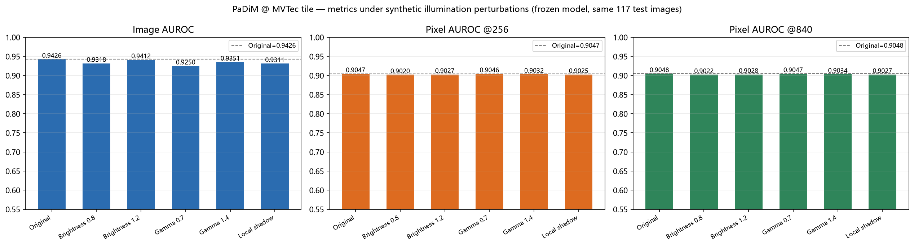
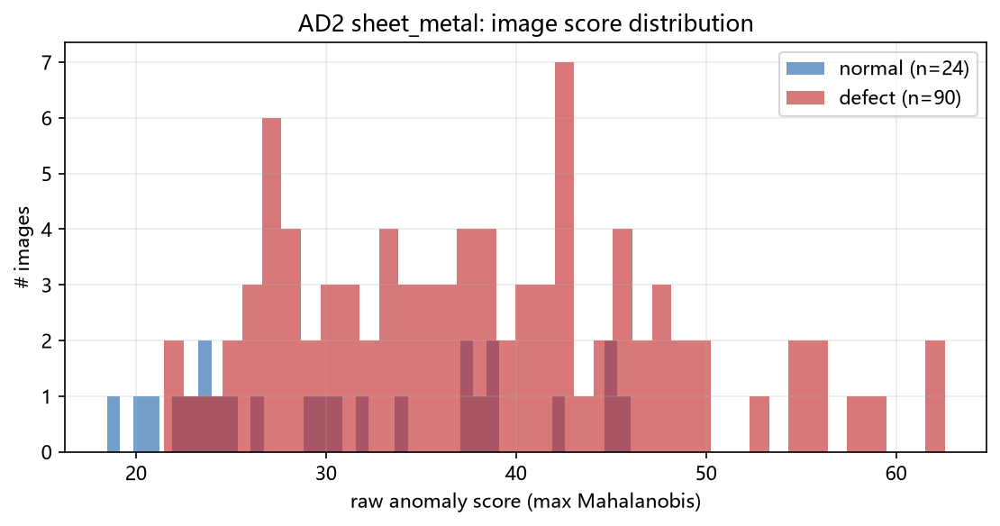
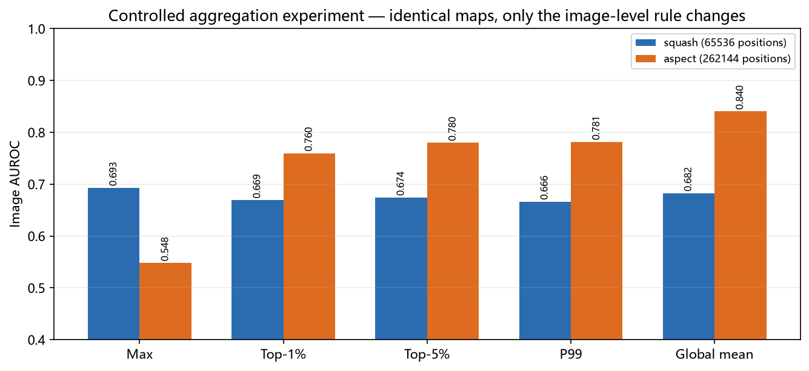
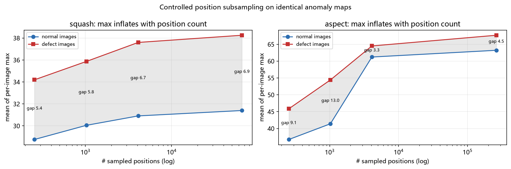

# industrial-anomaly-detection-benchmark

Reproducible industrial anomaly detection experiments with PaDiM, illumination
shift analysis, anomaly score aggregation, and evaluation pipeline auditing.

**This is an experimentation and evaluation repository, not a new algorithm.**
No method here is proposed as a state-of-the-art contribution. What it does
contain is a PaDiM baseline reproduced end-to-end on MVTec AD and MVTec AD 2, six
documented evaluation bugs (with the numbers that exposed them), a controlled
single-variable study of image-level score aggregation, and an honest account of
a research direction that was **stopped** because the signal did not justify a
paper. See [`docs/reports/Industrial_AD_Research_Summary.md`](docs/reports/Industrial_AD_Research_Summary.md).

---

## Findings at a glance

Four things worth knowing before reading any anomaly detection number,
all measured on this codebase:

1. **A missing `Normalize` call cost 0.10 AUROC and did not raise.** Anomalib 2.x
   applies ImageNet normalization inside a Lightning callback. Iterating a
   DataLoader directly bypasses it, and the model still returns plausible maps.
   Same weights, same 117 test images: Image AUROC **0.8442 → 0.9426** once fixed.
2. **The framework's own `PostProcessor` destroys rank metrics.** It applies a
   global affine map followed by `clip(·, 0, 1)`; on this data 95.6% of pixels were
   clipped to exactly 0 and only 41% of the ranking survived, taking Pixel AUROC
   **0.9047 → 0.5889**. Use raw distances for metrics, the post-processed map for
   human viewing.
3. **Real lighting change does degrade PaDiM — but less than the geometry does.**
   On MVTec AD 2 / sheet_metal, `shift_*` lighting raises the mean score of normal
   images by 10–27 points and collapses the defect-minus-normal gap by 77%.
   Synthetic (γ / brightness / shadow) perturbations, by contrast, move Image AUROC
   by at most 0.0177.
4. **Max aggregation is dominated by the image border on wide-format parts.**
   With the maps frozen and only the aggregation rule changed, Image AUROC goes
   **0.548 → 0.840** on the aspect-preserving input. 62.5% of normal images have
   their maximum inside the left/right 10% border band (median distance 0.000).
   A two-line "crop 2% of the columns, take the mean" reaches 0.8894 — which is
   exactly why this was not pursued as a method contribution.

Each of these is documented with its diagnosis in
[`docs/evaluation_pitfalls.md`](docs/evaluation_pitfalls.md).

---

## Features

| Feature | Entry point |
|---|---|
| PaDiM + ResNet-18 baseline on MVTec AD, with a proper train/val/test split | `src/run_padim.py`, `src/eval_core.py` |
| Dataset integrity checks: counts, mask pairing, image sizes, **content-level** train/test leakage | `src/dataset_check.py`, `src/ad2_check.py` |
| Inference that uses untruncated raw anomaly scores and an explicitly rebuilt preprocessing pipeline | `src/eval_core.py` |
| Post-processor audit: reproduce the framework's normalization formula and quantify the tie damage | `src/audit_postprocess.py` |
| Six deterministic synthetic illumination conditions (brightness ±, gamma ±, local shadow) | `src/perturbations.py`, `src/run_illumination.py` |
| MVTec AD 2 real-lighting evaluation with per-condition and per-scene paired analysis | `src/run_ad2.py`, `src/day3_analysis.py` |
| Controlled aggregation study (max / Top-1% / Top-5% / P99 / mean) with a SHA-256 assertion that the maps did not change | `src/day4_aggregation.py` |
| Scene-level grouped bootstrap for paired method comparison | `src/day4_aggregation.py` |
| Bit-level reproducibility check across independent runs | `scripts/compare_runs.py` |
| Failure-case visualisation with a shared colour scale | `src/day2_analysis.py`, `src/day4_figures.py` |

---

## Requirements

| Component | Verified version | Notes |
|---|---|---|
| OS | Windows 11 | Linux/macOS expected to work; **not verified** |
| Python | 3.12.7 | |
| PyTorch | 2.14.1+cu126 | CUDA 12.6 build from `download.pytorch.org` |
| torchvision | 0.29.1+cu126 | must match the torch build |
| anomalib | 2.7.0 | PaDiM implementation, unmodified |
| Lightning | 2.6.6 | pulled in by anomalib |
| GPU | RTX 3050 Laptop, 4 GB, sm_86 | PaDiM fit peaks at ~1.1 GB |

**CPU:** every script has a CPU path (`accelerator="cpu"`), the unit tests run on
CPU, and the metric functions are pure NumPy/sklearn. What is *not* verified is
the runtime on CPU — the recorded timings are GPU only. The tile illumination study
took ~44 s per condition on the GPU above.

**Other hardware is untested.** The versions above are the only combination that
was actually run. Newer or older packages will probably work; that is a guess.

---

## Install

PyTorch must be installed first, from the PyTorch index. On Windows the PyPI wheel
named `torch` is a **CPU-only** build (~120 MB) — installing it silently gives you
a machine without CUDA:

```bash
python -m venv .venv
# Windows
.venv\Scripts\activate
# Linux / macOS
# source .venv/bin/activate

pip install -r requirements-torch.txt   # CUDA build, ~2.5 GB on Windows
pip install -r requirements.txt         # everything else
```

Verify that CUDA actually computes, rather than merely importing:

```bash
python src/env_check.py            # exits non-zero if CUDA is unavailable
python src/env_check.py --allow-cpu  # smoke test on a CPU-only machine
```

**Network-restricted environments.** Two separate problems, both real here:

- Anomalib pulls the ImageNet backbone from Hugging Face on first use. Direct
  access returned HTTP 502 from this network; `configs/padim_tile.yaml` sets
  `HF_ENDPOINT=https://hf-mirror.com` and the scripts apply it. The weights are
  still the official `timm/resnet18.a1_in1k` checkpoint.
- `pip install` against `download.pytorch.org` while also resolving ordinary
  dependencies can hang indefinitely with no output and no CPU use. That is why
  the requirements are split into two files: download the wheel first, install
  `--no-deps` if needed, then install the rest from your usual index.

---

## Quick start

```bash
# 1) Unit tests - no dataset needed, ~25 s
python -m pytest tests -q

# 2) Put the datasets under datasets/raw/ (see "Datasets"), or point at them:
#    Windows:  set IDAD_DATA_ROOT=D:\data\mvtec
#    Linux:    export IDAD_DATA_ROOT=/data/mvtec

# 3) Verify the data before trusting any metric
python src/dataset_check.py --category tile
python src/ad2_check.py --archive datasets/raw/ad2/sheet_metal.tar.gz

# 4) Reproduce the corrected MVTec AD baseline + 6 synthetic lighting conditions (~5 min, GPU)
python src/run_illumination.py
python src/day2_analysis.py            # failure analysis + figures

# 5) Real lighting on MVTec AD 2 (~4 min, GPU)
python src/run_ad2.py --category sheet_metal --mode squash
python src/run_ad2.py --category sheet_metal --mode aspect --tag aspect
python src/day3_analysis.py

# 6) Controlled aggregation study (reuses the cached maps from step 5) (~3 min)
python src/day4_aggregation.py
python src/day4_figures.py
```

Outputs go to `results/` (metrics, logs) and `figures/` (plots). Both are
git-ignored; they are regenerated, not committed.

Every script accepts `--help`. Long runs print timings and peak GPU memory into
the JSON summaries.

### Which of these were re-verified while packaging this repository

See [`docs/REPRODUCTION_STATUS.md`](docs/REPRODUCTION_STATUS.md) for the exact list.
Short version: the unit tests, dataset checks and the tile illumination experiment
were re-run from this directory; the MVTec AD 2 runs were not re-executed during
packaging (they need the 1.5 GB extraction and ~8 min of GPU) and are reported
from the archived original runs.

---

## Datasets

Neither dataset is redistributed here. Both are **CC BY-NC-SA 4.0
(non-commercial)**; download them yourself from MVTec:

| Dataset | Source | Subset used | Size |
|---|---|---|---|
| MVTec AD | <https://www.mvtec.com/research-teaching/datasets/mvtec-ad> | `tile` | 335 MB |
| MVTec AD 2 | <https://www.mvtec.com/research-teaching/datasets/mvtec-ad-2> | `sheet_metal` | 1.5 GB |

MVTec AD 2's `fabric` category (10 GB) was **not** downloaded, so no second AD2
category is covered. `test_private` and `test_private_mixed` ship without ground
truth, are scored by the official server, and were never touched.

Expected directory layout: [`datasets/README.md`](datasets/README.md).
Integrity reports from the original runs: `docs/reports/dataset_check_tile.md`,
`docs/reports/ad2_check_sheet_metal.md`.

MVTec AD 2 encodes the lighting condition in the file name (`000_regular.png`,
`000_shift_2.png`, …), and every variant has its own ground-truth mask. That makes
per-scene pairing legitimate instead of guessed.

---

## Results

All numbers below come from real runs archived in `docs/results/`. Each table states
its dataset, configuration and protocol, because the pixel numbers are **not**
comparable across protocols (see pitfall 3).

### 1. MVTec AD / tile — is the baseline right?

Frozen PaDiM (ResNet-18, `n_features=100`, 256×256), 184 fit / 46 val / 117 test.
Threshold from validation normals only. Pixel metrics pooled over all test pixels
at the 256×256 model grid.

| Pipeline variant | Image AUROC | Pixel AUROC | Pixel AP | Status |
|---|---|---|---|---|
| Unnormalized input (Day 1 bug) | 0.8442 | 0.8387 | 0.2762 | ❌ invalid |
| Correct input + framework `PostProcessor` | 0.8849 | 0.5889 | 0.1334 | ❌ ties destroy ranking |
| **Correct input + raw scores** | **0.9426** | **0.9047** | **0.3279** | ✅ used everywhere below |

Full correct baseline: Image AP 0.9770, Pixel AUROC per image 0.9399, AUPRO 0.7675.
Pixel AUROC / AP at 840×840 are 0.9048 / 0.3282 — Δ ≤ 0.0002 versus 256, i.e.
upsampling the score map does not recover information.
At the validation threshold 55.48: FPR 0.0303 (1/33), recall 0.5833
(49/84), precision 0.98.

### 2. MVTec AD / tile — synthetic illumination (6 conditions, 117 images)

Model fitted once and frozen; only the input image is transformed. Perturbation
parameters were fixed in advance, not tuned.

| Condition | Image AUROC | Δ | Pixel AUROC | Δ | FPR | Recall |
|---|---|---|---|---|---|---|
| Original | 0.9426 | — | 0.9047 | — | 0.030 | 0.583 |
| Brightness ×0.8 | 0.9318 | −0.0108 | 0.9020 | −0.0027 | 0.030 | 0.583 |
| Brightness ×1.2 | 0.9412 | −0.0014 | 0.9027 | −0.0020 | 0.030 | 0.583 |
| Gamma 0.7 | 0.9250 | **−0.0177** | 0.9046 | −0.0001 | 0.030 | 0.571 |
| Gamma 1.4 | 0.9351 | −0.0076 | 0.9032 | −0.0015 | 0.030 | 0.595 |
| Local shadow | 0.9311 | −0.0115 | 0.9025 | −0.0022 | 0.030 | 0.619 |

Source: `docs/results/tile_synthetic_illumination.csv`, report
`docs/reports/Day2_Report.md`.

Read this carefully: the decreases are real but **small**, image-level losses are
4–10× larger than pixel-level ones, and the "no new false positives" result is
partly an artefact of where the threshold sits (it landed inside the normal
distribution; 32 of 33 normal images sit more than 10 points below it). Some
defects get *better* under γ 1.4 and shadow. This experiment does not show that
synthetic illumination breaks PaDiM.



### 3. MVTec AD 2 / sheet_metal — real lighting

PaDiM fitted on 137 `regular` training images, threshold from 19 `regular`
validation images, evaluated on `test_public` (24 normal + 90 defect, 19 scenes ×
6 lighting variants). Reference configuration: 256 px on the short side.

| Config | Image AUROC | Pixel AUROC | Pixel AP | AUPRO | FPR | Recall |
|---|---|---|---|---|---|---|
| `squash` 256×256 | 0.6931 | 0.8138 | 0.1638 | 0.1669 | 0.167 | 0.389 |
| `aspect` 256×1024 | 0.5472 | 0.8941 | 0.0407 | 0.4437 | 0.208 | 0.222 |

Pixel metrics for `sheet_metal` use masks rasterized from the original
4224×1056 ground truth; native-resolution evaluation OOMs (sklearn needs 3.79 GB
for one int64 array), so the long side is capped at 1024.

Per lighting condition (squash configuration):

| Condition | mean score, normal | mean score, defect | within-condition AUROC | FPR |
|---|---|---|---|---|
| `regular` | 23.5 | 33.9 | 0.867 | 0.00 |
| `overexposed` | 24.6 | 33.1 | 0.833 | 0.00 |
| `underexposed` | 23.7 | 34.2 | 0.917 | 0.00 |
| `shift_1` | 38.4 | 42.4 | 0.700 | 0.00 |
| `shift_2` | 44.7 | 47.1 | 0.650 | **1.00** |
| `shift_3` | 33.6 | 38.8 | 0.733 | 0.00 |

Exposure changes are nearly harmless; **changes in illumination direction are what
hurt**, raising normal scores by 10–27 points. The defect-minus-normal gap falls
from 10.4 to 2.4 (−77%). Pooling across conditions costs about 0.09 AUROC
(0.693 pooled vs 0.786 with a per-condition mean removed, an oracle upper bound).

Four simple preprocessing baselines were tried on the same frozen model — all
failed to help: brightness normalization 0.6671, fixed γ 0.85 0.6481, CLAHE
0.5583 (against 0.6931 baseline).

Sources: `docs/results/ad2_real_lighting.csv`,
`docs/results/ad2_per_lighting.csv`, report `docs/reports/Day3_Report.md`.



### 4. Image-level aggregation — controlled, one variable at a time

The anomaly maps were cached to `.npz` and **hashed before and after**; only the
scalar aggregation rule changed. Thresholds recomputed per rule from the
validation split. Pixel metrics are therefore constant by construction (asserted).

**MVTec AD 2 / sheet_metal, `squash`** (4096 grid cells)

| Rule | Image AUROC | Image AP | FPR | Recall |
|---|---|---|---|---|
| **max** | **0.6928** | 0.8925 | 0.167 | 0.389 |
| Top-1% | 0.6690 | 0.8853 | 0.417 | 0.589 |
| Top-5% | 0.6741 | 0.8935 | 0.500 | 0.600 |
| P99 | 0.6662 | 0.8902 | 0.500 | 0.589 |
| global mean | 0.6824 | 0.8974 | 0.292 | 0.544 |

**MVTec AD 2 / sheet_metal, `aspect`** (16384 grid cells)

| Rule | Image AUROC | Image AP | FPR | Recall |
|---|---|---|---|---|
| max | 0.5477 | 0.8282 | 0.208 | 0.222 |
| Top-1% | 0.7597 | 0.9283 | 0.500 | 0.756 |
| Top-5% | 0.7796 | 0.9359 | 0.500 | 0.733 |
| P99 | 0.7815 | 0.9370 | 0.500 | 0.733 |
| **global mean** | **0.8403** | **0.9508** | 0.375 | 0.778 |

**MVTec AD / tile** (exploratory; no validation maps were cached, so no
threshold metrics)

| Rule | max | Top-1% | Top-5% | P99 | global mean |
|---|---|---|---|---|---|
| Image AUROC | 0.9426 | 0.9708 | **0.9841** | 0.9816 | 0.9798 |

The winner **flips with configuration**, which is the actual result: there is no
universally better aggregation rule here. Scene-level grouped bootstrap
(19 scenes, 2000 resamples, shared indices) puts the `aspect` gains well away from
zero — mean vs max **+0.293 [+0.136, +0.476]** — while every `squash` contrast
straddles zero.



**Mechanism.** With the maps held fixed and only the number of sampled positions
changed, the mean per-image maximum for *normal* images rises from 36.7 to 63.2
(+72%) in the `aspect` configuration while the defect-minus-normal gap collapses
from 13.0 to 3.3. And 62.5% of normal images have their maximum in the left/right
10% border band of the strip (58.3% / 79.2% counting all four borders). Max is
measuring the workpiece edge, not the defect.



A fixed, pre-registered "crop 2% of the columns, then take the mean" reaches
**0.8894** on `aspect`, beating every rule in the table above. That result is
exploratory (it uses `test_public`) and it is also the reason this direction was
abandoned — see `docs/reports/Day4_Decision.md` and
`docs/reports/Industrial_AD_Final_Audit.md`.

---

## Reproducibility

Determinism settings, the split manifest, seeds and the metric definitions are in
[`docs/experimental_protocol.md`](docs/experimental_protocol.md).

The check that matters: two independent processes, each refitting PaDiM from
scratch, over 6 conditions × 117 images, produced **bit-identical per-image
scores** (`max|Δ| = 0.000e+00`, all metric deltas `0.00e+00`). Reproduce with:

```bash
python src/run_illumination.py --tag run2
python scripts/compare_runs.py
```

What is *not* verified: seed sensitivity (only seed 42 was swept), other hardware,
other dataset categories, CPU runtimes, and anything on the private test splits.

---

## Visualisations

`assets/figures/` holds eleven charts, all rendered from numbers: metric
comparisons, score histograms, extreme-value curves, border-distance histograms.

**No dataset pixels are included.** Both datasets are CC BY-NC-SA 4.0, so the
heatmap overlays that the original runs produced are deliberately excluded.
Regenerate them locally after downloading the data:

```bash
python src/day2_analysis.py     # -> figures/day2_illumination/  (incl. heatmap overlays)
python src/day3_analysis.py     # -> figures/day3_real_illumination/
python src/day4_figures.py      # -> figures/day4_aggregation/
```

The overlay functions accept a `vmin`/`vmax` so that panels share one colour scale;
each figure in the original reports states whether it does.

---

## Known limitations

- **Two categories only** — MVTec AD `tile` and MVTec AD 2 `sheet_metal`. No
  multi-category claim is supported.
- **One model.** PaDiM/ResNet-18. PatchCore and `wide_resnet50_2` were not run, so
  there is no baseline comparison and no SOTA claim.
- **Small public test split for AD2.** 114 images but only 19 independent scenes
  and 4 normal images per lighting condition. Bootstrap CIs are ~0.4 wide; they
  support "there is a difference", not "the difference is 0.05".
- **Some numbers are exploratory.** Anything computed on `test_public` after being
  used to choose a question — including the crop-2% result — is exploratory,
  including in tables here where it is labelled as such.
- **Pixel metrics carry a protocol dependency.** Day 3 and Day 4 AUPRO differ by
  0.057 on identical heatmaps because of mask rasterization. Never compare a pixel
  number across protocols.
- **Synthetic ≠ real.** The six lighting conditions are synthetic stress tests.
  They are not evidence about factory lighting.
- **Not a published method.** There is no paper behind this repository, and no
  claim of novelty.

---

## Documentation map

| Document | Contents |
|---|---|
| [`docs/evaluation_pitfalls.md`](docs/evaluation_pitfalls.md) | the six measured evaluation traps, with numbers |
| [`docs/experimental_protocol.md`](docs/experimental_protocol.md) | splits, model, scoring, metrics, seeds, statistical limits |
| [`docs/REPRODUCTION_STATUS.md`](docs/REPRODUCTION_STATUS.md) | what was re-verified while packaging, what was not |
| [`docs/results/`](docs/results/) | the result tables quoted above, as CSV/JSON |
| [`docs/reports/`](docs/reports/) | original day-by-day lab records (Chinese), with per-file status |
| [`datasets/README.md`](datasets/README.md) | expected data layout and how to verify it |

---

## Licence

No `LICENSE` file yet — the outbound licence for this code has not been decided,
so it is left unset rather than guessed. Third-party components, datasets and
pretrained weights retain their own licences; see
[`THIRD_PARTY_NOTICES.md`](THIRD_PARTY_NOTICES.md). The datasets are
**non-commercial** and must be obtained from MVTec.

---

## References

- P. Bergmann, M. Fauser, D. Sattlegger, C. Steger. *MVTec AD — A Comprehensive
  Real-World Dataset for Unsupervised Anomaly Detection.* CVPR 2019; extended
  version IJCV 2021.
- T. Defard, A. Setkov, A. Loesch, R. Audigier. *PaDiM: a Patch Distribution
  Modeling Framework for Anomaly Detection and Localization.* ICPR 2021.
  arXiv:2011.08785
- MVTec AD 2, IJCV 2026. <https://www.mvtec.com/research-teaching/datasets/mvtec-ad-2>
- anomalib — <https://github.com/open-edge-platform/anomalib>
- Related work on aggregation and score calibration is surveyed in
  [`docs/reports/Day4_Aggregation_Novelty.md`](docs/reports/Day4_Aggregation_Novelty.md)
  and [`docs/reports/Day3_Novelty_Matrix.md`](docs/reports/Day3_Novelty_Matrix.md).
