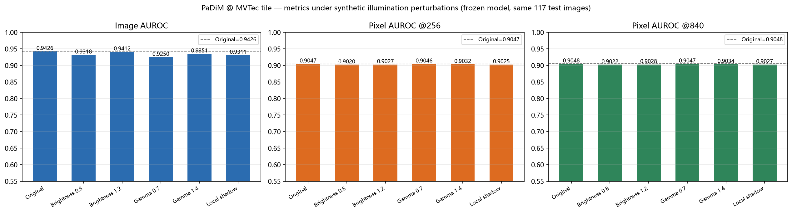
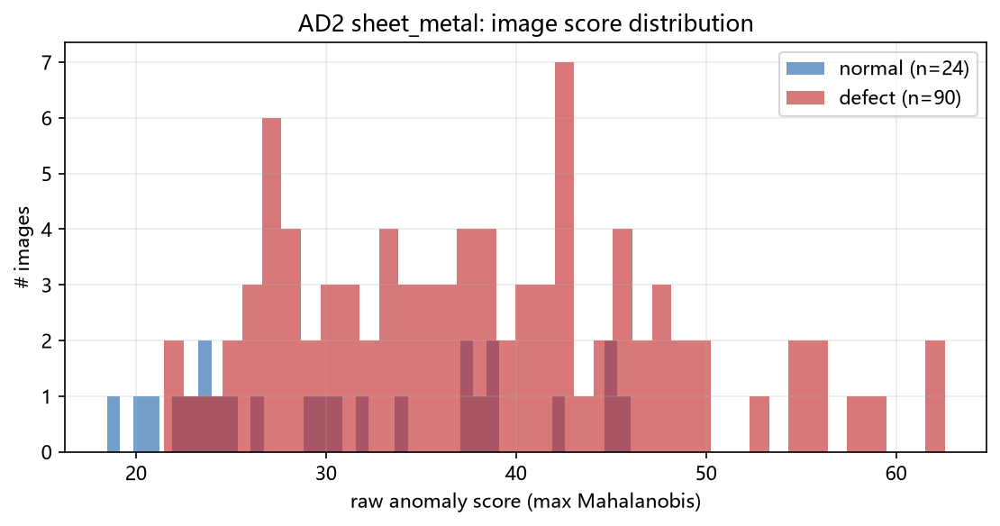
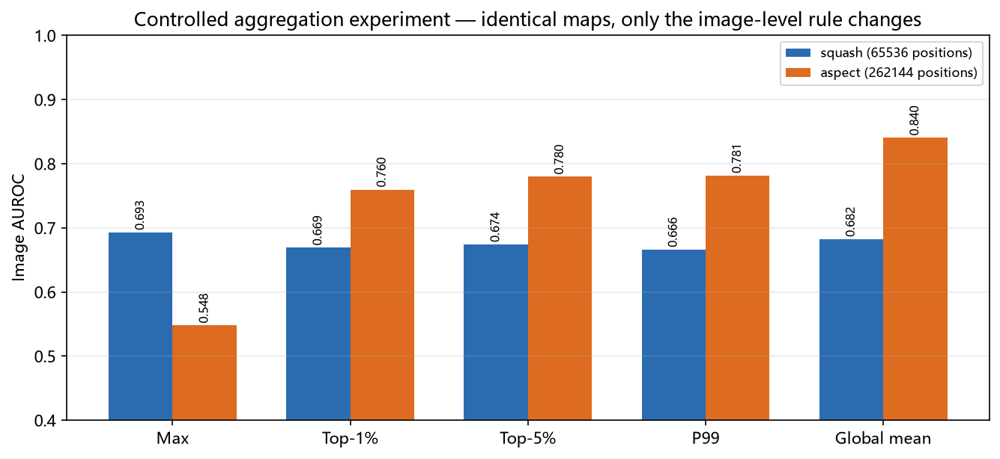
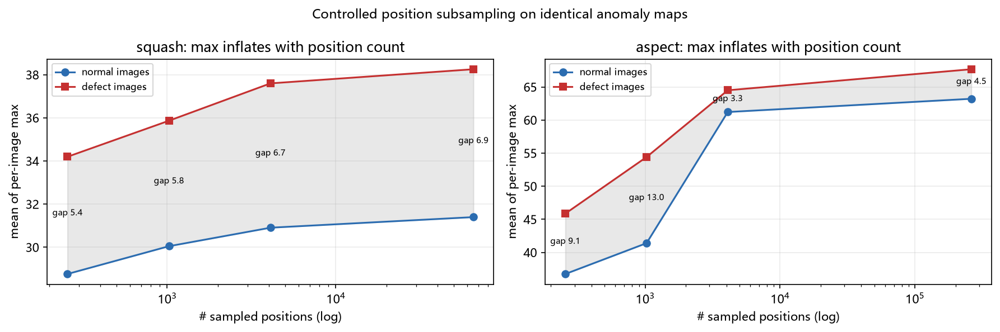

# 工业异常检测实验与评估基准（可复现）

PaDiM 基线复现、光照漂移诊断、图像级异常分数聚合受控实验，以及一套把评估口径讲清楚的工程实现。

**这是一个"实验与评估"仓库，不是新算法。** 这里没有任何方法被宣称为 SOTA 贡献。
它包含的是：在 MVTec AD 与 MVTec AD 2 上端到端复现的 PaDiM 基线、六个有实测数字支撑的
评估陷阱、一次只改一个变量的聚合受控实验，以及一条**被主动终止**的研究方向的完整记录
（因为信号强度不足以支撑一篇论文）。详见
[`docs/reports/Industrial_AD_Research_Summary.md`](docs/reports/Industrial_AD_Research_Summary.md)。

> 英文版见 [`README.md`](README.md)。逐日实验记录是中文的，在 `docs/reports/`。

---

## 四条先看结论

1. **漏调一次 `Normalize`，掉了 0.10 AUROC，而且不报错。** anomalib 2.x 把 ImageNet 归一化
   放在 Lightning 回调里；直接遍历 dataloader 会绕过它，模型照样输出看起来正常的热力图。
   同权重、同 117 张测试图：修好后 Image AUROC **0.8442 → 0.9426**。
2. **框架自带的 `PostProcessor` 会毁掉排序类指标。** 它是全局仿射 + `clip(·,0,1)`，
   本数据上 95.6% 的像素被压成恰好 0，排序仅保留 41%，Pixel AUROC **0.9047 → 0.5889**。
   算指标用原始距离，给人看的热力图再用后处理结果。
3. **真实光照确实会让 PaDiM 退化，但影响小于输入几何。** MVTec AD 2 / sheet_metal 上，
   `shift_*` 光照把正常图平均分抬高 10~27 分、缺陷-正常间隔塌缩 77%；而合成的
   γ / 亮度 / 阴影扰动对 Image AUROC 的影响最多 0.0177。
4. **宽幅工件上 Max 聚合测的是图像边缘。** 冻结热力图、只换聚合规则，保持宽高比配置下
   Image AUROC **0.548 → 0.840**；62.5% 的正常图最大值落在左右 10% 边界带内（中位距离 0.000）。
   两行"裁掉 2% 列宽再取均值"就到 0.8894——这正是它不能当方法贡献的原因。

每一条的诊断过程与数字在 [`docs/evaluation_pitfalls.md`](docs/evaluation_pitfalls.md)。

---

## 功能

| 能力 | 入口 |
|---|---|
| MVTec AD 上 PaDiM + ResNet-18 基线（含正确的 train/val/test 划分） | `src/run_padim.py`、`src/eval_core.py` |
| 数据集完整性校验：计数、掩码对应、尺寸、**内容级**训练/测试泄漏 | `src/dataset_check.py`、`src/ad2_check.py` |
| 使用**未截断原始分数**的推理，显式重建预处理管线 | `src/eval_core.py` |
| 后处理审计：复现框架归一化公式，量化并列（ties）造成的损失 | `src/audit_postprocess.py` |
| 6 种确定性合成光照条件（亮度 ±、Gamma ±、局部阴影） | `src/perturbations.py`、`src/run_illumination.py` |
| MVTec AD 2 真实光照评估，含分条件与逐场景配对分析 | `src/run_ad2.py`、`src/day3_analysis.py` |
| 聚合受控实验（max / Top-1% / Top-5% / P99 / mean），带热力图 SHA-256 断言 | `src/day4_aggregation.py` |
| 以场景为单位的分组 Bootstrap（配对比较） | `src/day4_aggregation.py` |
| 跨独立运行的位级可复现性比对 | `scripts/compare_runs.py` |
| 统一色标的失效案例可视化 | `src/day2_analysis.py`、`src/day4_figures.py` |

---

## 环境要求

| 组件 | 已验证版本 | 说明 |
|---|---|---|
| 操作系统 | Windows 11 | Linux / macOS 预期可用，**未验证** |
| Python | 3.12.7 | |
| PyTorch | 2.14.1+cu126 | 来自 `download.pytorch.org` 的 CUDA 12.6 构建 |
| torchvision | 0.29.1+cu126 | 必须与 torch 构建配对 |
| anomalib | 2.7.0 | PaDiM 官方实现，未改动 |
| Lightning | 2.6.6 | 由 anomalib 引入 |
| GPU | RTX 3050 Laptop 4GB, sm_86 | PaDiM 拟合显存峰值约 1.1 GB |

**CPU：** 每个脚本都有 CPU 路径，单元测试全在 CPU 上跑，指标函数是纯 NumPy/sklearn。
未验证的是 CPU 上的**运行时间**——记录的耗时都是 GPU 的（tile 光照实验每条件约 44 秒）。

**其他硬件组合未测试。** 上表是唯一真正跑过的组合。

---

## 安装

先在 PyTorch 官方索引装 torch。Windows 上 PyPI 里那个叫 `torch` 的 wheel 是**纯 CPU 版**
（约 120MB），装了会得到一个没有 CUDA 的环境，而且不报错：

```bash
python -m venv .venv
# Windows
.venv\Scripts\activate
# Linux / macOS
# source .venv/bin/activate

pip install -r requirements-torch.txt   # CUDA 版，Windows 上约 2.5GB
pip install -r requirements.txt         # 其余依赖
```

验证 CUDA 真的能算，而不只是能 import：

```bash
python src/env_check.py              # CUDA 不可用时返回非零
python src/env_check.py --allow-cpu  # 纯 CPU 机器上做冒烟测试
```

**受限网络下有两个真实的坑：**

- anomalib 首次使用会从 Hugging Face 拉 ImageNet 骨干。本机直连返回 502，
  `configs/padim_tile.yaml` 设了 `HF_ENDPOINT=https://hf-mirror.com`，脚本会自动应用；
  权重本身仍是官方 `timm/resnet18.a1_in1k`。
- 一边指向 `download.pytorch.org` 一边解析普通依赖时，pip 可能**静默卡死**
  （进程 CPU 和 I/O 全为 0，无输出）。所以依赖被拆成两个文件：先下 wheel，
  必要时 `--no-deps` 本地装，再从常用源补齐其余。

---

## 快速开始

```bash
# 1) 单元测试（不需要数据集，约 25 秒）
python -m pytest tests -q

# 2) 把数据放到 datasets/raw/（见"数据集"），或指向已有副本：
#    Windows:  set IDAD_DATA_ROOT=D:\data\mvtec
#    Linux:    export IDAD_DATA_ROOT=/data/mvtec

# 3) 先校验数据，再相信任何指标
python src/dataset_check.py --category tile
python src/ad2_check.py --archive datasets/raw/ad2/sheet_metal.tar.gz

# 4) 复现修正后的 MVTec AD 基线 + 6 种合成光照（约 5 分钟，GPU）
python src/run_illumination.py
python src/day2_analysis.py

# 5) MVTec AD 2 真实光照（约 4 分钟，GPU）
python src/run_ad2.py --category sheet_metal --mode squash
python src/run_ad2.py --category sheet_metal --mode aspect --tag aspect
python src/day3_analysis.py

# 6) 聚合受控实验（复用第 5 步缓存的热力图，约 3 分钟）
python src/day4_aggregation.py
python src/day4_figures.py
```

输出落在 `results/`（指标、日志）与 `figures/`（图），两者都已 gitignore——
它们是重新生成的产物，不入库。

所有脚本都支持 `--help`。长任务会把耗时和显存峰值写进 JSON 摘要。

---

## 数据集

仓库不包含任何数据集。两者都是 **CC BY-NC-SA 4.0（非商用）**，请自行从 MVTec 下载：

| 数据集 | 来源 | 使用子集 | 体积 |
|---|---|---|---|
| MVTec AD | <https://www.mvtec.com/research-teaching/datasets/mvtec-ad> | `tile` | 335 MB |
| MVTec AD 2 | <https://www.mvtec.com/research-teaching/datasets/mvtec-ad-2> | `sheet_metal` | 1.5 GB |

MVTec AD 2 的 `fabric`（10GB）**没有下载**，因此不覆盖第二个 AD2 类别。
`test_private` / `test_private_mixed` 不公开 GT、由官方服务器评测，从未使用。

目录结构见 [`datasets/README.md`](datasets/README.md)；原始运行的校验报告在
`docs/reports/dataset_check_tile.md`、`docs/reports/ad2_check_sheet_metal.md`。

MVTec AD 2 的光照条件编码在文件名里（`000_regular.png`、`000_shift_2.png` …），
且每个变体都有对应 GT 掩码——所以按场景配对是可靠的，不是靠文件名猜的。

---

## 实验结果

下表全部来自真实运行，原始表在 `docs/results/`。每张表都标注了数据集、配置与口径，
因为像素级数字**不能跨口径比较**（见陷阱 3）。

### 1. MVTec AD / tile：基线到底对不对

冻结 PaDiM（ResNet-18，`n_features=100`，256×256），184 拟合 / 46 验证 / 117 测试，
阈值只用验证集正常样本。像素指标为全测试像素池化、在 256×256 网格上计算。

| 管线变体 | Image AUROC | Pixel AUROC | Pixel AP | 状态 |
|---|---|---|---|---|
| 未归一化输入（Day 1 的 bug） | 0.8442 | 0.8387 | 0.2762 | ❌ 无效 |
| 正确输入 + 框架 `PostProcessor` | 0.8849 | 0.5889 | 0.1334 | ❌ 并列毁掉排序 |
| **正确输入 + 原始分数** | **0.9426** | **0.9047** | **0.3279** | ✅ 后续全部使用 |

完整基线：Image AP 0.9770，逐图 Pixel AUROC 0.9399，AUPRO 0.7675；
840×840 下 Pixel AUROC / AP 为 0.9048 / 0.3282（与 256 相差 ≤0.0002，说明上采样不恢复信息）。
验证阈值 55.48 下：误报率 0.0303（1/33）、召回率 0.5833（49/84）、精确率 0.98。

### 2. MVTec AD / tile：合成光照（6 条件 × 117 图）

模型只拟合一次并冻结，只变换输入图；扰动参数事先固定，未调优。

| 条件 | Image AUROC | Δ | Pixel AUROC | Δ | 误报率 | 召回率 |
|---|---|---|---|---|---|---|
| Original | 0.9426 | — | 0.9047 | — | 0.030 | 0.583 |
| 亮度 ×0.8 | 0.9318 | −0.0108 | 0.9020 | −0.0027 | 0.030 | 0.583 |
| 亮度 ×1.2 | 0.9412 | −0.0014 | 0.9027 | −0.0020 | 0.030 | 0.583 |
| Gamma 0.7 | 0.9250 | **−0.0177** | 0.9046 | −0.0001 | 0.030 | 0.571 |
| Gamma 1.4 | 0.9351 | −0.0076 | 0.9032 | −0.0015 | 0.030 | 0.595 |
| 局部阴影 | 0.9311 | −0.0115 | 0.9025 | −0.0022 | 0.030 | 0.619 |

请按这个方式读：下降真实但**很小**；图像级损失比像素级大 4~10 倍；
"没有新增误报"部分源于阈值位置（它落在正常分布内部，33 张正常图里 32 张距阈值 10 分以上）；
γ 1.4 和阴影下还有缺陷被"救回"。**这个实验不能证明合成光照会破坏 PaDiM。**



### 3. MVTec AD 2 / sheet_metal：真实光照

PaDiM 在 137 张 `regular` 训练图上拟合，阈值来自 19 张 `regular` 验证图，
在 `test_public`（24 正常 + 90 缺陷，19 场景 × 6 光照）上评估。

| 配置 | Image AUROC | Pixel AUROC | Pixel AP | AUPRO | 误报率 | 召回率 |
|---|---|---|---|---|---|---|
| `squash` 256×256 | 0.6931 | 0.8138 | 0.1638 | 0.1669 | 0.167 | 0.389 |
| `aspect` 256×1024 | 0.5472 | 0.8941 | 0.0407 | 0.4437 | 0.208 | 0.222 |

sheet_metal 的像素指标使用由原始 4224×1056 GT 栅格化的掩码；原生分辨率评估会 OOM
（sklearn 需要 3.79GB 的单个 int64 数组），因此长边截到 1024。

分光照条件（squash 配置）：

| 条件 | 正常图均分 | 缺陷图均分 | 组内 AUROC | 误报率 |
|---|---|---|---|---|
| `regular` | 23.5 | 33.9 | 0.867 | 0.00 |
| `overexposed` | 24.6 | 33.1 | 0.833 | 0.00 |
| `underexposed` | 23.7 | 34.2 | 0.917 | 0.00 |
| `shift_1` | 38.4 | 42.4 | 0.700 | 0.00 |
| `shift_2` | 44.7 | 47.1 | 0.650 | **1.00** |
| `shift_3` | 33.6 | 38.8 | 0.733 | 0.00 |

曝光变化几乎无害；**真正有害的是光照方向变化**，它把正常图分数整体抬高 10~27 分，
缺陷-正常间隔从 10.4 塌到 2.4（−77%）。跨条件池化损失约 0.09 AUROC
（池化 0.693，按条件去均值这个 oracle 上界为 0.786）。

四种简单预处理在同一冻结模型上全部失败：亮度归一化 0.6671、固定 γ 0.85 为 0.6481、
CLAHE 0.5583（基线 0.6931）。



### 4. 图像级聚合：一次只改一个变量

热力图先缓存为 `.npz` 并在聚合前后做 **SHA-256 断言**，只改标量聚合规则；
阈值按规则各自从验证集重算。像素指标因此按构造保持不变（已在代码里断言）。

**MVTec AD 2 / sheet_metal，`squash`**（4096 个网格单元）

| 规则 | Image AUROC | Image AP | 误报率 | 召回率 |
|---|---|---|---|---|
| **max** | **0.6928** | 0.8925 | 0.167 | 0.389 |
| Top-1% | 0.6690 | 0.8853 | 0.417 | 0.589 |
| Top-5% | 0.6741 | 0.8935 | 0.500 | 0.600 |
| P99 | 0.6662 | 0.8902 | 0.500 | 0.589 |
| 全图均值 | 0.6824 | 0.8974 | 0.292 | 0.544 |

**MVTec AD 2 / sheet_metal，`aspect`**（16384 个网格单元）

| 规则 | Image AUROC | Image AP | 误报率 | 召回率 |
|---|---|---|---|---|
| max | 0.5477 | 0.8282 | 0.208 | 0.222 |
| Top-1% | 0.7597 | 0.9283 | 0.500 | 0.756 |
| Top-5% | 0.7796 | 0.9359 | 0.500 | 0.733 |
| P99 | 0.7815 | 0.9370 | 0.500 | 0.733 |
| **全图均值** | **0.8403** | **0.9508** | 0.375 | 0.778 |

**MVTec AD / tile**（探索性；未缓存验证集热力图，故无阈值类指标）

| 规则 | max | Top-1% | Top-5% | P99 | 全图均值 |
|---|---|---|---|---|---|
| Image AUROC | 0.9426 | 0.9708 | **0.9841** | 0.9816 | 0.9798 |

**最优规则随配置翻转**，这才是真正的结论：这里不存在普适更优的聚合规则。
以 19 个场景为单位、共用重采样索引的分组 Bootstrap 显示 `aspect` 下的提升远离 0
（均值 vs max **+0.293 [+0.136, +0.476]**），而 `squash` 下所有对比都跨 0。



**机制。** 冻结热力图、只改采样位置数：`aspect` 下正常图的每图最大值从 36.7 涨到 63.2
（+72%），缺陷-正常间隔从 13.0 塌到 3.3；62.5% 的正常图最大值落在钢带左右 10% 边界带内
（四边口径为 58.3% / 79.2%）。Max 测的是工件边缘，不是缺陷。



一条事先固定、未做搜索的"裁掉 2% 列宽再取均值"在 `aspect` 上达到 **0.8894**，
优于上表所有规则。该结果属探索性（使用 `test_public`），也正是这条方向被放弃的原因——
见 `docs/reports/Day4_Decision.md` 与 `docs/reports/Industrial_AD_Final_Audit.md`。

---

## 可复现性

确定性设置、划分清单、随机种子与指标定义都在
[`docs/experimental_protocol.md`](docs/experimental_protocol.md)。

关键验证：两次独立进程各自从零重新拟合，覆盖 6 条件 × 117 图，
逐图分数**位级完全一致**（`max|Δ| = 0.000e+00`，所有指标差值 `0.00e+00`）。复现命令：

```bash
python src/run_illumination.py --tag run2
python scripts/compare_runs.py
```

**未验证**：种子敏感性（只扫了 seed 42）、其他硬件、其他数据集类别、CPU 运行时间，
以及私有测试划分上的任何结论。

---

## 可视化

`assets/figures/` 有 11 张图，全部由数字渲染：指标对比、分数直方图、极值曲线、边界距离直方图。

**不含任何数据集像素。** 两个数据集都是 CC BY-NC-SA 4.0，因此原运行产生的热力图叠加图
被有意排除。下载数据后在本地重新生成：

```bash
python src/day2_analysis.py     # -> figures/day2_illumination/
python src/day3_analysis.py     # -> figures/day3_real_illumination/
python src/day4_figures.py      # -> figures/day4_aggregation/
```

---

## 已知限制

- **只有两个类别**：MVTec AD `tile` 与 MVTec AD 2 `sheet_metal`，不支持任何多类别结论。
- **只有一个模型**：PaDiM/ResNet-18。未跑 PatchCore 与 `wide_resnet50_2`，
  因此没有基线对比，也没有 SOTA 声明。
- **AD2 公开测试集很小**：114 张图但只有 19 个独立场景，每个光照条件仅 4 张正常图。
  Bootstrap 置信区间宽约 0.4，只支持"有差异"，不支持"差异是 0.05"。
- **部分数字是探索性的**：凡是在 `test_public` 上先看过结果再选择问题的（包括裁 2% 那条），
  都是探索性结果，表中已标注。
- **像素指标带口径依赖**：同一批热力图，Day 3 与 Day 4 的 AUPRO 相差 0.057，
  差异来自掩码栅格化。像素数字不能跨口径比较。
- **合成 ≠ 真实**：六种光照是合成压力测试，不是关于工厂照明的证据。
- **不是已发表方法**：仓库背后没有论文，也不主张任何创新性。

---

## 文档索引

| 文档 | 内容 |
|---|---|
| [`docs/evaluation_pitfalls.md`](docs/evaluation_pitfalls.md) | 六个实测的评估陷阱，附数字 |
| [`docs/experimental_protocol.md`](docs/experimental_protocol.md) | 划分、模型、打分、指标、种子、统计限制 |
| [`docs/REPRODUCTION_STATUS.md`](docs/REPRODUCTION_STATUS.md) | 本次打包重新验证了什么、什么没验证 |
| [`docs/results/`](docs/results/) | 上文引用的结果表（CSV/JSON） |
| [`docs/reports/`](docs/reports/) | 逐日实验记录原文（中文），每个文件标注状态 |
| [`datasets/README.md`](datasets/README.md) | 期望的数据目录结构与校验方法 |

---

## 许可

**暂无 `LICENSE` 文件**——代码的对外许可尚未确定，因此留空而不是猜一个。
第三方组件、数据集与预训练权重各自保留其原许可，见
[`THIRD_PARTY_NOTICES.md`](THIRD_PARTY_NOTICES.md)。数据集为**非商用**，须从 MVTec 获取。

---

## 参考文献

- P. Bergmann, M. Fauser, D. Sattlegger, C. Steger. *MVTec AD — A Comprehensive
  Real-World Dataset for Unsupervised Anomaly Detection.* CVPR 2019；扩展版 IJCV 2021.
- T. Defard, A. Setkov, A. Loesch, R. Audigier. *PaDiM: a Patch Distribution
  Modeling Framework for Anomaly Detection and Localization.* ICPR 2021. arXiv:2011.08785
- MVTec AD 2, IJCV 2026. <https://www.mvtec.com/research-teaching/datasets/mvtec-ad-2>
- anomalib — <https://github.com/open-edge-platform/anomalib>
- 相关工作的对照见 [`docs/reports/Day4_Aggregation_Novelty.md`](docs/reports/Day4_Aggregation_Novelty.md)
  与 [`docs/reports/Day3_Novelty_Matrix.md`](docs/reports/Day3_Novelty_Matrix.md)。
